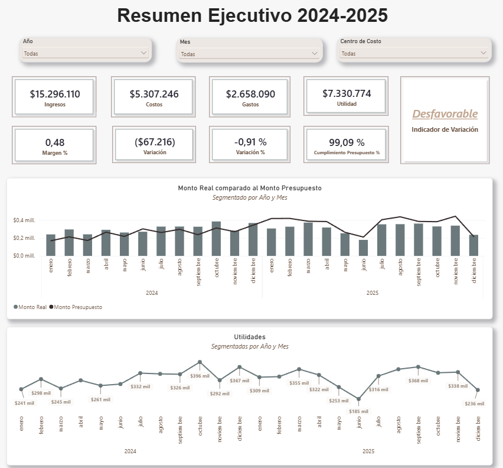
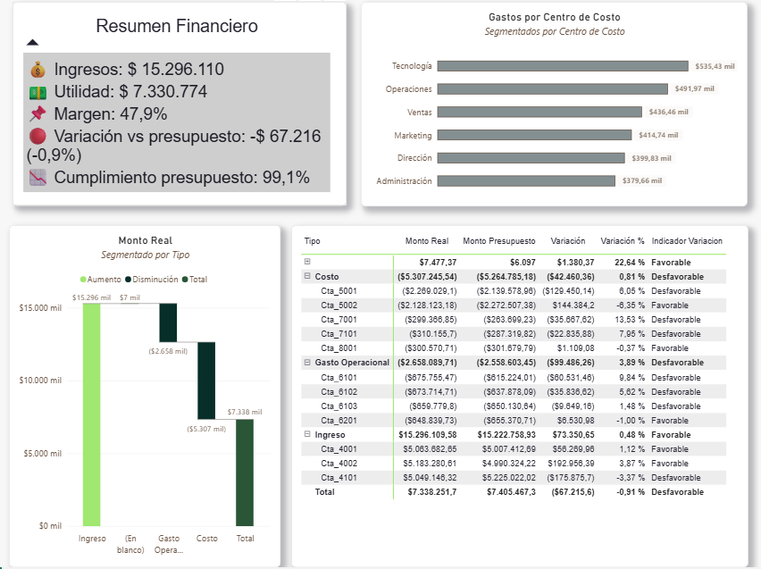

markdown
# Dashboard Financiero — Real vs. Presupuesto

Dashboard ejecutivo en Power BI para el seguimiento financiero de una empresa, 
comparando resultados reales contra presupuesto, con desglose por tipo de cuenta, 
centro de costo y evolución mensual.

## 🖼️ Pre-visualización

## 📊 Contenido del dashboard

- **Tarjetas KPI**: Ingresos, Utilidad, Margen %, Cumplimiento de Presupuesto.
- **Real vs. Presupuesto**: comparación por tipo de cuenta (Ingreso, Costo, Gasto Operacional).
- **Evolución mensual**: tendencia de Monto Real y Monto Presupuesto a lo largo del año.
- **Gastos por Centro de Costo**: ranking de áreas según ejecución de gasto.
- **Estado de Resultados**: matriz con Ingresos, Costos y Gastos por tipo de cuenta.
- **Waterfall financiero**: cascada desde Ingresos hasta Utilidad.
- **Resumen ejecutivo dinámico**: texto generado automáticamente con los indicadores clave 
  del período filtrado.

## 🗂️ Modelo de datos

Modelo en esquema de estrella, con una tabla de hechos y cuatro dimensiones:

| Tabla | Rol | Campos clave |
|---|---|---|
| `FactFinanzasRaw` | Hechos | Monto, Fecha, Escenario, CuentaID, CentroCostoID |
| `DimCuentas` | Dimensión | CuentaID, NombreCuenta, Tipo (Ingreso / Costo / Gasto Operacional) |
| `DimCentroCosto` | Dimensión | CentroCostoID, CentroCosto, Área, Responsable, País |
| `DimEscenario` | Dimensión | Escenario (Real / Presupuesto), Descripción |
| `Calendario` | Dimensión de fecha | Date, Año, Mes Nro, Mes, Trimestre (marcada como tabla de fechas) |

## 🧮 Medidas DAX principales

**Base**
- `Monto Total`, `Monto Real`, `Monto Presupuesto`

**Estado de Resultados**
- `Ingresos`, `Costos`, `Gastos`, `Utilidad`, `Margen %`

**Variación vs. Presupuesto**
- `Variación`, `Variación %`, `Cumplimiento Presupuesto %`, `Indicador Variacion` 
  (Favorable / Desfavorable)

**Inteligencia de tiempo**
- `Real Mes Anterior`, `Variación Mes Anterior`, `Variación % Mes Anterior`, `Monto Real YTD`

**Otras**
- `Ranking CentroCosto` (ranking de centros de costo por Gastos)
- `Resumen Financiero` (texto ejecutivo dinámico, con indicadores visuales 🟢🔴📈📉 
  que se adapta a los filtros activos)

## 🛠️ Cómo se construyó

- Modelo armado manualmente en esquema de estrella.
- Columnas de calendario y clasificación generadas en Power Query (M).
- Medidas DAX desarrolladas progresivamente: desde cálculos base, pasando por 
  comparación de escenarios, hasta inteligencia de tiempo y texto dinámico.
- Validación cruzada de medidas (Estado de Resultados, Waterfall y tarjetas KPI) 
  para asegurar consistencia entre visuales.

## 📁 Requisitos

- Power BI Desktop (versión reciente).
- Archivo de datos de origen (Excel) con las tablas `FactFinanzasRaw`, `DimCuentas`, 
  `DimCentroCosto` y `DimEscenario`.

## 📌 Notas

Este proyecto fue desarrollado como ejercicio práctico de modelamiento y DAX en Power BI, 
cubriendo desde medidas base hasta inteligencia de tiempo y visualización ejecutiva.
